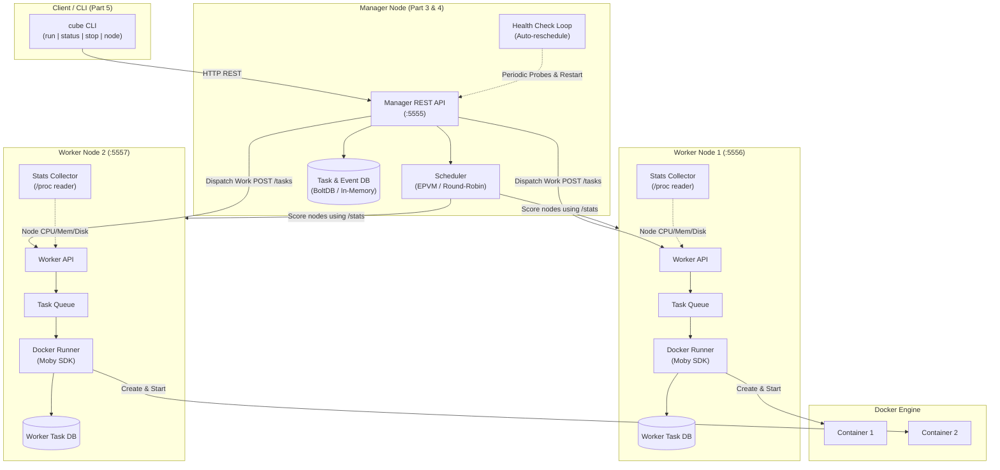
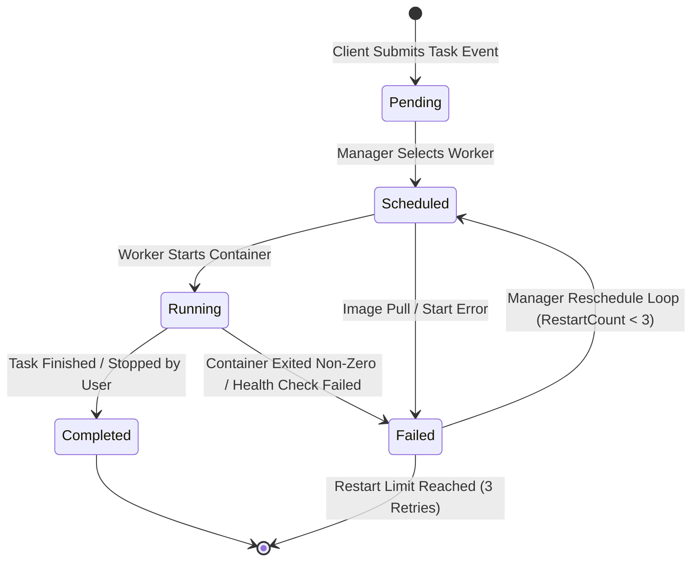

# Cube Orchestrator

[](https://golang.org)
[](https://github.com/moby/moby)
[](https://github.com/boltdb/bolt)
[](https://github.com/spf13/cobra)
[](LICENSE)

A lightweight, distributed container orchestrator built from scratch in Go. Cube models the fundamental control loops, scheduling mechanics, container runtime interactions, and state management that power production orchestrators like **Kubernetes** and **HashiCorp Nomad**.

Built following [*Build an Orchestrator in Go (From Scratch)*](https://www.manning.com/books/build-an-orchestrator-in-go-from-scratch) by Tim Boring (Manning Publications), covering **Parts 1 through 5 (Chapters 1–12)**.

---

## Table of Contents

- [Project Status](#project-status)
- [Architecture](#architecture)
- [System Components](#system-components)
- [Task Lifecycle & State Machine](#task-lifecycle--state-machine)
- [Scheduling Strategies](#scheduling-strategies)
- [Storage Engines](#storage-engines)
- [CLI Reference](#cli-reference)
- [Getting Started](#getting-started)
  - [Prerequisites](#prerequisites)
  - [Building the Binary](#building-the-binary)
  - [Running a Local Cluster (2 Workers + 1 Manager)](#running-a-local-cluster-2-workers--1-manager)
- [Task Specification Format](#task-specification-format)
- [HTTP API Reference](#http-api-reference)
- [Design Decisions & Beyond the Book](#design-decisions--beyond-the-book)
- [Roadmap (Chapter 13 & Beyond)](#roadmap-chapter-13--beyond)
- [Credits](#credits)

---

## Project Status

All milestones through **Chapter 12** are implemented and working:

| Component | Book Chapter | Status | Description |
|---|---|---|---|
| **Task Model & State Machine** | Ch. 2, 3 | ✅ Complete | Finite state machine with validated state transitions (`task/state.go`). |
| **Docker Container Runtime** | Ch. 3 | ✅ Complete | Moby SDK client with CPU/Memory limits, port mapping, and async log streaming. |
| **Worker Daemon & Task Queue** | Ch. 4 | ✅ Complete | FIFO task queue, worker lifecycle loop, container start/stop/inspect. |
| **Worker REST API** | Ch. 5 | ✅ Complete | REST API (`/tasks`, `/stats`) built with Chi router. |
| **Node Metrics Collector** | Ch. 6 | ✅ Complete | Linux `/proc` stats reader for CPU, memory, and disk utilization via `goprocinfo`. |
| **Manager Core** | Ch. 7 | ✅ Complete | Central control plane, worker node registry, task dispatching, and state tracking. |
| **Manager REST API** | Ch. 8 | ✅ Complete | Manager HTTP API (`/tasks`, `/tasks/{taskID}`, `/nodes`). |
| **Health Probing & Rescheduling** | Ch. 9 | ✅ Complete | Background health checks (`/health`) with restart limits and automatic recovery. |
| **Advanced Schedulers** | Ch. 10 | ✅ Complete | Pluggable scheduler interface: **Round-Robin** and **EPVM** (Lieb's square ice constant). |
| **Persistent Storage** | Ch. 11 | ✅ Complete | Pluggable store interface with **In-Memory** and embedded **BoltDB** backends. |
| **Unified Command-Line Interface** | Ch. 12 | ✅ Complete | Cobra-based CLI (`cube-orchestrator`) with `worker`, `manager`, `run`, `status`, `stop`, and `node`. |

---

## Architecture



---

## System Components

- **[`task/`](task/)**: Defines task configurations, container specifications, finite states, transition rules, and the Docker runtime interface wrapper built on the modern Moby SDK.
- **[`worker/`](worker/)**: Runs on each worker node. Maintains an in-memory queue, runs the container execution loop, synchronizes container inspect data, tracks local state, and serves the worker REST API.
- **[`manager/`](manager/)**: The central brain. Accepts incoming tasks, evaluates candidate worker nodes via the selected scheduler, dispatches tasks, aggregates cluster state, and runs continuous health check and recovery loops.
- **[`scheduler/`](scheduler/)**: Implements node selection algorithms (`SelectCandidateNodes`, `Score`, and `Pick`) to balance workloads across the cluster.
- **[`node/`](node/)**: Abstraction representing physical or virtual machines, storing resource limits (cores, RAM, disk), allocated capacities, and fetching real-time metrics with retry logic.
- **[`store/`](store/)**: Persistence layer abstraction implementing key-value operations (`Put`, `Get`, `List`, `Count`) backed by either fast in-memory maps or embedded BoltDB files.
- **[`stats/`](stats/)**: Low-level Linux performance collector reading `/proc/stat`, `/proc/meminfo`, `/proc/loadavg`, and `/proc/diskstats`.
- **[`cmd/`](cmd/)**: Command-line interface built with Cobra, providing operations for running nodes and managing tasks.

---

## Task Lifecycle & State Machine

Every task managed by Cube transitions through an explicit, validated finite state machine:



### State Definitions & Transition Matrix

| Source State | Permitted Destination States |
|---|---|
| `Pending` (0) | `Scheduled` |
| `Scheduled` (1) | `Scheduled`, `Running`, `Failed` |
| `Running` (2) | `Running`, `Completed`, `Failed` |
| `Completed` (3) | *(Terminal state)* |
| `Failed` (4) | *(Terminal state, or rescheduled up to 3 times)* |

---

## Scheduling Strategies

Cube includes two swappable scheduling implementations satisfying the `scheduler.Scheduler` interface:

### 1. Round-Robin (`roundrobin`)
Distributes tasks cyclically among all available worker nodes without considering resource load. Ideal for uniform workloads or lightweight local development.

### 2. EPVM — Enhanced Parallel Virtual Machine (`epvm`)
A greedy scheduler that calculates the marginal cost of placing a task on each candidate node. It scores nodes using a cost function based on **Lieb's square ice constant** ($W \approx 1.5396$):

$$\text{Cost} = W^{\text{Load}_{\text{new}}} - W^{\text{Load}_{\text{current}}}$$

- **Feasibility Filter:** Excludes nodes that do not satisfy disk requirements ($t.\text{Disk} \le \text{Node.DiskAvailable}$).
- **Multi-Resource Scoring:** Samples live CPU and memory load via each worker node's `/stats` API over an interval, calculating composite cost penalties to avoid hot spots and resource exhaustion.
- **Placement:** The candidate node yielding the minimum cost increase is selected.

---

## Storage Engines

Cube supports two storage backends for task and event states, configurable via `--dbtype` / `--dbType`:

1. **`memory` (Default):**
   - High-speed in-memory hash maps (`sync`-free for transient worker cycles).
   - Ideal for quick local testing and development where persistence across restarts is not required.

2. **`persistent`:**
   - Backed by embedded **BoltDB** (`bbolt`) files.
   - Saves tasks to `tasks.db` and task lifecycle events to `events.db` on the manager.
   - Workers store task run histories in `<worker-name>_task.db`.
   - Preserves state across daemon restarts.

---

## CLI Reference

Cube includes a unified command-line interface built with [Cobra](https://github.com/spf13/cobra). The CLI allows you to start node daemons (`manager`, `worker`), deploy and inspect tasks (`run`, `status`, `stop`), and view cluster topologies (`node`).

### Installation

#### Option 1: Local Binary Build
```bash
go build -o cube main.go
```

#### Option 2: Install Globally
Install into `$GOPATH/bin` (make sure `$GOPATH/bin` is in your `$PATH`):
```bash
go install .
# Symlink or alias for convenience:
alias cube="cube-orchestrator"
```

---

### Command Overview

| Command | Description | Example Usage |
|---|---|---|
| `manager` | Launch the central manager control plane daemon | `cube manager -p 5555 -s epvm -w localhost:5556,localhost:5557` |
| `worker` | Launch a worker node daemon | `cube worker -p 5556 -n worker-1 -d persistent` |
| `run` | Submit a task specification JSON to the cluster | `cube run -f task1.json -m localhost:5555` |
| `status` | Query and list all tasks across the cluster | `cube status -m localhost:5555` |
| `stop` | Stop and remove a running container | `cube stop <task-uuid> -m localhost:5555` |
| `node` | List cluster worker nodes, capacities, and roles | `cube node -m localhost:5555` |
| `completion` | Generate shell autocompletion script (bash/zsh/fish) | `source <(cube completion bash)` |

---

### Command Deep-Dive & Terminal Output Previews

#### 1. `cube node`
Queries the manager's `/nodes` endpoint to display registered worker nodes, total memory, disk capacity, assigned roles, and running task counts.

```bash
$ cube node -m localhost:5555
NAME              MEMORY (MiB)    DISK (GiB)    ROLE      TASKS    
localhost:5556    15822           468           worker    2        
localhost:5557    15822           468           worker    1        
```

#### 2. `cube run`
Submits a JSON task specification (`TaskEvent`) to the manager, which selects a worker via the scheduler and dispatches the container run request.

```bash
$ cube run -f task1.json
2026/10/18 03:00:00 Using manager: localhost:5555
2026/10/18 03:00:00 Using file: /home/izenberk/Desktop/projects/cube-orchestrator/task1.json
2026/10/18 03:00:00 Successfully sent task request to manager
```

#### 3. `cube status`
Retrieves cluster-wide task states, formatting start times into human-readable relative durations via `go-units`.

```bash
$ cube status -m localhost:5555
ID                                      NAME                CREATED         STATE      CONTAINERNAME       IMAGE                        
bb1d59ef-9fc1-4e4b-a44d-db571eeed203    test-chapter-9.1    4 minutes ago   Running    test-chapter-9.1    timboring/echo-server:latest 
21b23589-5d2d-4731-b5c9-a97e9832d021    test-chapter-9.2    2 minutes ago   Running    test-chapter-9.2    timboring/echo-server:latest 
95fbe134-7f19-496a-acfc-c7853e5b4cd2    test-chapter-9.3    35 seconds ago  Running    test-chapter-9.3    timboring/echo-server:latest 
```

#### 4. `cube stop`
Takes the **Task ID** (listed in `cube status`), issues a `DELETE` request to the manager, triggers container teardown on the worker, and transitions the task to `Completed`.

```bash
$ cube stop bb1d59ef-9fc1-4e4b-a44d-db571eeed203
2026/10/18 03:05:00 Task bb1d59ef-9fc1-4e4b-a44d-db571eeed203 has been stopped.
```

---

### Command Flags Reference

```
manager flags:
  -H, --host string        Host or IP address to bind (default "0.0.0.0")
  -p, --port int           Port on which manager listens (default 5555)
  -w, --workers strings    Comma-separated list of worker node endpoints (default ["localhost:5556"])
  -s, --scheduler string   Scheduler algorithm: "epvm" (resource-aware) or "roundrobin" (default "epvm")
  -d, --dbType string      Store engine: "memory" or "persistent" (default "memory")

worker flags:
  -H, --host string        Host or IP address to bind (default "0.0.0.0")
  -p, --port int           Port on which worker listens (default 5556)
  -n, --name string        Worker identifier (default "worker-<uuid>")
  -d, --dbtype string      Store engine: "memory" or "persistent" (default "memory")

run flags:
  -m, --manager string     Target manager address (default "localhost:5555")
  -f, --filename string    Path to task JSON specification (default "task.json")

status / node / stop flags:
  -m, --manager string     Target manager address (default "localhost:5555")
```

---

### Shell Autocompletion

Cobra provides built-in autocompletion for shell command lines and flags.

#### Bash
```bash
# Temporarily enable for current session:
source <(./cube completion bash)

# Persist for your user profile:
./cube completion bash > ~/.bash_completion.d/cube
```

#### Zsh
```bash
# If shell completion is not already enabled in your environment:
echo "autoload -U compinit; compinit" >> ~/.zshrc

# Generate zsh completion script:
./cube completion zsh > "${fpath[1]}/_cube"
```

#### Fish
```bash
./cube completion fish | source
# Persist across sessions:
./cube completion fish > ~/.config/fish/completions/cube.fish
```

---


## Getting Started

### Prerequisites

- **Go:** `1.26+` (or modern Go with toolchain support)
- **Docker Engine:** Running locally with permissions for the current user (`unix:///var/run/docker.sock`)
- **OS:** Linux (required for `/proc` stats reader in `stats/`)

### Building the Binary

Compile the application into a standalone executable:

```bash
git clone https://github.com/Izenberk/cube-orchestrator.git
cd cube-orchestrator
go build -o cube main.go
```

Alternatively, you can run commands directly using `go run main.go <command>`.

---

### Running a Local Cluster (2 Workers + 1 Manager)

Follow this quickstart to launch a multi-node cluster on your machine:

#### Step 1: Start Worker 1 (Terminal 1)
```bash
./cube worker --host 0.0.0.0 --port 5556 --name worker-1 --dbtype persistent
```

#### Step 2: Start Worker 2 (Terminal 2)
```bash
./cube worker --host 0.0.0.0 --port 5557 --name worker-2 --dbtype persistent
```

#### Step 3: Start the Manager (Terminal 3)
```bash
./cube manager \
  --host 0.0.0.0 \
  --port 5555 \
  --workers localhost:5556,localhost:5557 \
  --scheduler epvm \
  --dbType persistent
```

#### Step 4: Verify Cluster Nodes (Terminal 4)
```bash
./cube node
```
*Output:*
```text
NAME              MEMORY (MiB)    DISK (GiB)    ROLE      TASKS
localhost:5556    15822           468           worker    0
localhost:5557    15822           468           worker    0
```

#### Step 5: Submit Tasks
Create and run a task specification (e.g. `task1.json`):

```bash
./cube run -f task1.json
```

#### Step 6: Monitor Task Status
```bash
./cube status
```
*Output:*
```text
ID                                      NAME                CREATED        STATE      CONTAINERNAME       IMAGE
bb1d59ef-9fc1-4e4b-a44d-db571eeed203    test-chapter-9.1    12s ago        Running    test-chapter-9.1    timboring/echo-server:latest
```

#### Step 7: Stop a Task
```bash
./cube stop bb1d59ef-9fc1-4e4b-a44d-db571eeed203
```

---

## Task Specification Format

Tasks are defined in JSON as a `TaskEvent` wrapping the task configuration:

```json
{
  "ID": "a7aa1d44-08f6-443e-9378-f5884311019e",
  "State": 2,
  "Task": {
    "ID": "bb1d59ef-9fc1-4e4b-a44d-db571eeed203",
    "Name": "echo-service",
    "Image": "timboring/echo-server:latest",
    "Cpu": 0.5,
    "Memory": 128,
    "Disk": 256,
    "ExposedPorts": {
      "7777/tcp": {}
    },
    "PortBindings": {
      "7777/tcp": "7777"
    },
    "RestartPolicy": "on-failure",
    "HealthCheck": "/health"
  }
}
```

### Key Fields

- `ID`: Unique task UUID.
- `Name`: Container name assigned in Docker.
- `Image`: Container image name and tag (pulled automatically if not cached).
- `Cpu` / `Memory` / `Disk`: Resource requirements used by the scheduler to pick candidates and enforce container limits.
- `ExposedPorts`: Set of ports to open inside the container.
- `PortBindings`: Host-to-container port mapping rules.
- `HealthCheck`: HTTP route path periodically queried by the manager (e.g. `/health`). If non-200 or unreachable, the task is restarted.

---

## HTTP API Reference

### Manager API (`:5555`)

| Method | Endpoint | Description |
|---|---|---|
| `POST` | `/tasks` | Submit a new task event (`TaskEvent` JSON body) |
| `GET` | `/tasks` | Retrieve list of all tracked tasks |
| `DELETE` | `/tasks/{taskID}` | Schedule a task to be stopped and cleaned up |
| `GET` | `/nodes` | List registered worker nodes and resource capacities |

### Worker API (`:5556`, `:5557`, etc.)

| Method | Endpoint | Description |
|---|---|---|
| `POST` | `/tasks` | Enqueue a task event for local container execution |
| `GET` | `/tasks` | Return all tasks currently tracked by this worker |
| `DELETE` | `/tasks/{taskID}` | Stop and remove the task container |
| `GET` | `/stats` | Return live host metrics (CPU usage, memory, disk stats) |

---

## Design Decisions & Beyond the Book

- **Moby SDK Modernization:** Upgraded from the legacy Docker client to official `github.com/moby/moby/client` and `api` packages.
- **Async Container Log Streaming:** Containers stream stdout/stderr asynchronously via `stdcopy.StdCopy` on background goroutines, preventing blocking operations in the worker control loop.
- **Isolated Control Loops:** State polling, metrics collection, work dispatching, and health checks each run in dedicated goroutines, isolating I/O bottlenecks.
- **Fail-Safe Container Inspection:** Added nil guards and structured error handling to prevent worker crashes when containers exit unexpectedly or disappear.
- **Extensible Storage & Schedulers:** Designed with clean Go interfaces (`store.Store` and `scheduler.Scheduler`), allowing memory and persistent backends or scheduling algorithms to be swapped via CLI flags.

---

## Roadmap (Chapter 13 & Beyond)

- [ ] **mTLS Security:** Authenticate and encrypt communication between CLI, Manager, and Workers.
- [ ] **Dynamic Worker Registration:** Workers automatically register with the manager via heartbeat leases instead of static CLI flags.
- [ ] **High Availability (HA):** Raft consensus algorithm across multiple manager nodes to eliminate the single point of failure.
- [ ] **Test Suite:** Automated unit and integration tests using `testcontainers-go`.
- [ ] **Service Discovery & Overlay Networking:** Built-in DNS and virtual IP routing for inter-task communication.

---

## Credits

Architecture, mechanics, and design follow [*Build an Orchestrator in Go (From Scratch)*](https://www.manning.com/books/build-an-orchestrator-in-go-from-scratch) by **Tim Boring** (Manning Publications).
