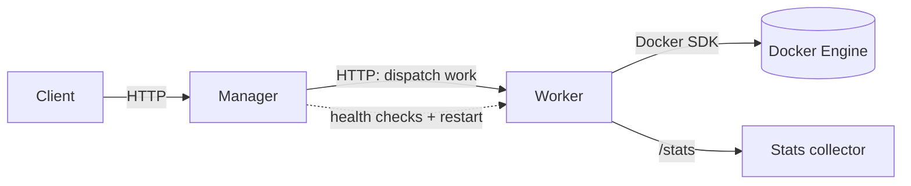

# Cube Orchestrator

A container orchestrator built from scratch in Go. A **manager** accepts tasks and dispatches them to **workers**; each worker runs tasks as Docker containers, exposes an HTTP API, and reports its own resource stats. The manager continuously health-checks running tasks and restarts the ones that fail.

Built while working through [*Build an Orchestrator in Go (From Scratch)*](https://www.manning.com/books/build-an-orchestrator-in-go-from-scratch) by Tim Boring (Manning). This is a learning project: the goal is to understand how orchestrators like Kubernetes and Nomad work internally, not to replace them.

**Progress:** Parts 1-3 implemented (task runtime, worker, metrics, manager, health checks). Next: scheduler extraction and persistent task storage.

## Status

| Component | Status | Notes |
|---|---|---|
| Task model + state machine | Working | Explicit state definitions in `task/state.go` |
| Docker runner | Working | Run, start, stop, inspect; CPU limits (NanoCPUs); async log streaming via the Moby SDK |
| Worker | Working | Task queue, execution loop, state transitions, inspect polling, HTTP API (chi) |
| Stats | Working | CPU, memory, disk and task count via `goprocinfo`; exposed at `/stats` (Linux only) |
| Manager | Working | Task intake, worker selection, work dispatch, task state tracking, manager API |
| Health checks | Working | Manager probes running tasks and restarts failed ones |
| Scheduler | Skeleton | Placement logic currently lives in `manager.SelectWorker` |
| Node | Skeleton | Not yet used for placement decisions |
| Tests | Not started | Planned, see Roadmap |

## Architecture



| Package | Responsibility | Status |
|---|---|---|
| `task/` | Task model, state transitions, Docker wrapper (run/stop/inspect, log streaming) | Working |
| `worker/` | Owns the task queue, runs containers, serves the worker HTTP API | Working |
| `manager/` | Accepts tasks, selects a worker, sends work, runs health checks | Working |
| `stats/` | Collects CPU, memory and disk metrics for a machine | Working |
| `scheduler/` | Will own placement decisions, extracted from the manager | Skeleton |
| `node/` | Represents a machine and its capacity | Skeleton |

## Task lifecycle

```
Pending -> Scheduled -> Running -> Completed
                           \-----> Failed
```
<!-- verify: replace with the exact states defined in task/state.go -->

1. A client submits a task to the manager, which selects a worker and sends the work over HTTP.
2. The worker queues the task; its execution loop dequeues it and starts a container through the Docker SDK.
3. State transitions are recorded as the container starts, runs, stops, or fails.
4. The worker polls container inspect data (host ports, health, restart count) and reports it back.
5. The manager's health-check loop restarts tasks that report as failed.

Control loops (task processing, state updates, health checks) run in separate goroutines so a slow container or a slow probe never blocks the API.

## Getting started

### Prerequisites

- Go (see `go.mod` for the version)
- Docker Engine running locally
- Linux, for the stats collector (it reads `/proc`)

### Run

```bash
git clone https://github.com/Izenberk/cube-orchestrator.git
cd cube-orchestrator
cp .env.example .env     # worker and manager use separate settings
go run .
```
<!-- verify: document how main.go selects worker vs manager mode -->

### Configuration

| Variable | Purpose | Example |
|---|---|---|
| `<VAR>` | `<purpose>` | `<value>` |

<!-- fill from .env.example: one row per variable -->

### Try it

```bash
# Worker stats
curl http://localhost:<WORKER_PORT>/stats

# Submit a task through the manager
curl -X POST http://localhost:<MANAGER_PORT>/tasks -d @examples/task1.json
```
<!-- verify: real ports and routes; paste one trimmed real response -->

## Design decisions

- **Moby SDK over the legacy Docker client.** The runner was migrated to the Moby SDK to stay on the maintained client API and to support streaming container logs.
- **Async log streaming.** Reading logs synchronously would block the worker's execution loop for the lifetime of the container, so logs are streamed on a separate goroutine.
- **Explicit task state machine.** Every state change goes through one defined set of states, which keeps worker, manager and health-check logic agreeing on what a task's status means.
- **One package per concept.** `task`, `worker`, `manager`, `stats` stay independently readable and testable, and make it straightforward to extract the scheduler out of the manager later.
- **Environment-based configuration.** Worker and manager have separate env files (`godotenv` + `.env.example`), so ports and hosts stay out of code.
- **Defensive handling of container inspection.** A nil-result guard in the worker's polling loop prevents a panic when inspect returns nothing for a container that has disappeared.

## Beyond the book

- Migrated the Docker runner to the Moby SDK and added async log streaming
- Added CPU limits via NanoCPUs on container resources
- Split worker and manager configuration into separate env files
<!-- verify: keep only what differs from the book's reference implementation -->

## Roadmap

- [ ] Extract placement logic from `manager.SelectWorker` into `scheduler/`, starting with round-robin, then load-aware using worker `/stats`
- [ ] Persist task state so it survives manager restarts
- [ ] Unit tests for the task state machine and manager health-check logic
- [ ] Document and test a multi-worker setup end to end
- [ ] CLI (Part 5 of the book)

## Known limitations

- Task state is held in memory and is lost on restart <!-- verify -->
- No automated tests yet
- Stats collection requires Linux
- Worker and manager APIs are unauthenticated and intended for local development only

## Credits

Architecture and structure follow *Build an Orchestrator in Go (From Scratch)* by Tim Boring (Manning).
